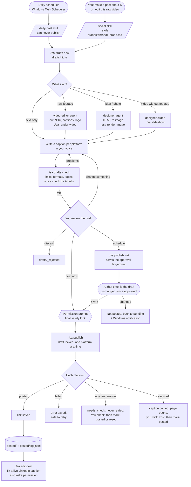

# ViralForge: a social media agent that runs in Claude Code

You describe a post in plain words. Claude Code designs the image or edits the video, writes a caption in
your voice for each platform, and shows you the draft. **It posts only after you approve that exact draft.**
It supports Instagram, Facebook Pages, YouTube (videos and Shorts) and LinkedIn. YouTube community posts,
personal Facebook profiles and LinkedIn company pages are "assisted": the agent prepares everything and you
click Post.

There is no app or server. Claude Code is the agent, and the `./sa` toolbox gives it the editing, rendering
and posting tools. Setup is in [SETUP.md](SETUP.md), and the rules the agent follows are in [CLAUDE.md](CLAUDE.md).

## How a post flows



## Safety built in

- **Approval first.** Every publish or caption edit goes through a Claude Code permission prompt, enforced by
  a hook in [.claude/hooks/gate_publish.py](.claude/hooks/gate_publish.py). Unattended daily runs can create
  drafts, but they can't post.
- **No double posts.** Network calls are retried, but the one call that makes a post public never is. If its
  answer gets lost, the target is marked `needs_check` and waits for you to confirm what happened.
- **One run at a time.** A draft is locked while it's being published, so a scheduled run and a manual run
  can't both post it.
- **Scheduled posts go out exactly as approved.** If you edit the draft after scheduling, it isn't posted
  and you get a notification.
- **Failures stay contained.** If one platform crashes, the other platforms still post, and the error is
  saved in the draft.
- **Logins are checked ahead of time.** LinkedIn logins last 60 days; `drafts check` warns 7 days before
  one expires.
- **Secrets stay private.** The agent never reads `.env` or `secrets/` and never prints tokens.

## Sounding like you, not like AI

`./sa voice <draft>` (also part of `drafts check`) flags captions that read as machine-written. It looks
for stock phrases, arrow-bullet templates, "it's not X, it's Y", em-dash stacks and too many hashtags.
The agent rewrites until the check passes. The writing rules are in the **Writing captions** section of
[CLAUDE.md](CLAUDE.md).

To tag a company on LinkedIn, add its URN once to `brands/<brand>/mentions.json`. From then on, writing
`@Replit` in a caption posts a real tag.

## Commands

| Command | What it does |
|---|---|
| `./sa drafts new <video\|image\|text\|slideshow> <title>` | start a draft folder |
| `./sa render-image <file.html> --size WxH` | HTML design to PNG and JPG |
| `./sa render-video <draft>` / `./sa slideshow <draft>` | edit plan or slides to `final.mp4` |
| `./sa probe` / `frames` / `transcribe` | inspect a video, see frames, speech to text |
| `./sa drafts list\|show\|check\|reject\|history` | manage drafts (never posts) |
| `./sa drafts mark-posted\|reset <draft> <platform:account>` | resolve assisted or `needs_check` targets |
| `./sa voice <draft>` | check captions for AI tells |
| `./sa accounts` | connected accounts and login expiry |
| `./sa publish <draft> [--at "YYYY-MM-DD HH:MM"] [--only k] [--cancel]` | **post or schedule** (asks permission) |
| `./sa edit-post <draft> <platform:account>` | **change a live caption** (LinkedIn, asks permission) |

In Claude Code you can just talk to it, or use `/social`, `/edit-video`, `/daily-post` and `/review`.

## Project layout

```
sa                      the toolbox entry point
scripts/                one file per command; scripts/platforms/ has one plug-in per platform
.claude/skills/         /social, /edit-video, /daily-post, /review
.claude/agents/         designer and video-editor subagents
.claude/hooks/          the publish safety lock
brands/<name>/          voice, look, hashtags, daily plan, mentions.json, logo, fonts, music
drafts/  posted/        your work (not in git)
tests/                  offline tests, which never post anything
```

To add a platform, drop a new file into `scripts/platforms/`. The contract is described in
[scripts/platforms/\_\_init\_\_.py](scripts/platforms/__init__.py).

## Tests

```bash
~/.venvs/social-agent/bin/python -m unittest discover -s tests -v
```
